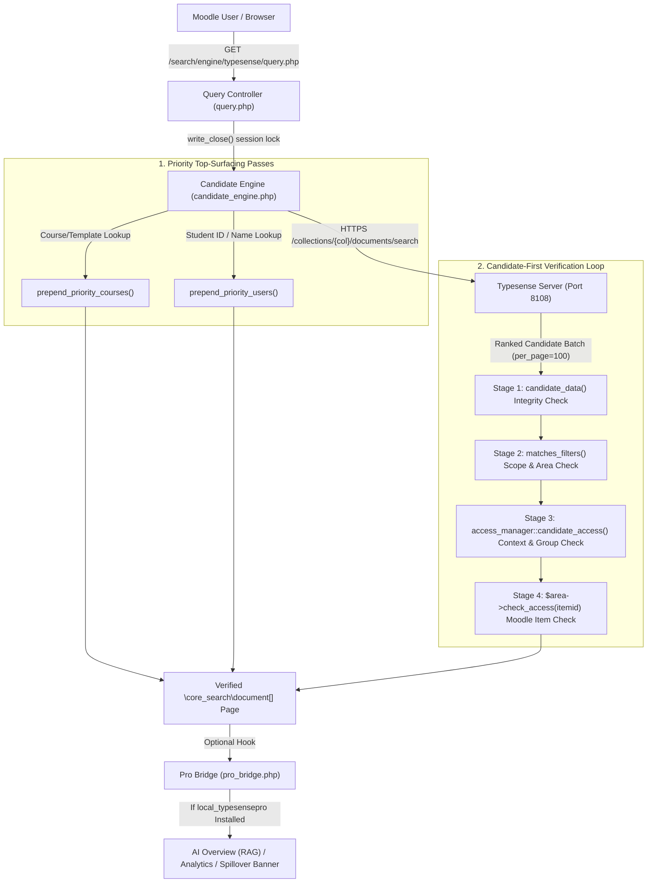

# Architecture & Security Model (`search_typesense`)

This document details the internal architecture, permission verification pipeline, priority ranking algorithms, Typesense collection schema, and extension bridge of the **Typesense Global Search Engine (`search_typesense`)** plugin for Moodle.

---

## 1. High-Level System Architecture



---

## 2. Why Candidate-First Pagination Exists

In Moodle core's default `\core_search\manager::search()` flow, Moodle calls `get_areas_user_accesses()` **before** querying the search backend. On a multi-year institution with 10,000+ courses and 500,000+ course modules:
1. System-level Managers, Support Staff, or Site Administrators trigger `get_my_courses()` / `get_fast_modinfo()` expansion across thousands of courses.
2. PHP either exhausts `128 MB` of worker memory or spends 10–30 seconds building an enormous list of context IDs before a single search query reaches the search server.

### How `candidate_engine` Solves This
`\search_typesense\candidate_engine` reverses the execution order:
1. **Narrow by Scope First (`access_manager::scope_courseids()`):** Applies lightweight course scope filters (`Current courses`, `Historical / other courses`, or `Search everything`) and owner visibility (`owneruserid:0 || owneruserid:$USER->id`) directly in Typesense's `filter_by` clause.
2. **Fetch Ranked Candidates in Batches (`BATCH_SIZE = 100`):** Retrieves the top candidate hits from Typesense (`max_candidates = 200`, `drop_tokens_threshold = 0`, `prioritize_token_position = true`).
3. **Evaluate Moodle Contexts Strictly on Candidate Courses:** Passes only the distinct `courseid` values present in the current candidate batch into `access_manager::candidate_access($courseids, $filters)`.
4. **Stop as Soon as the Page Prefix Is Filled:** To render Page `p` (`DISPLAY_RESULTS_PER_PAGE = 10`), the engine stops scanning as soon as `(p + 1) * 10 + 1` authorized documents are verified (the `+ 1` lookahead proves whether `hasmore` is true without leaking unverified backend hit counts).

---

## 3. Four-Stage Permission Verification Pipeline

Every candidate document returned by Typesense must pass four independent checks before it can be converted into a `\core_search\document` or shown to the user:

| Stage | Method | Security Invariant Enforced |
| :--- | :--- | :--- |
| **Stage 1** | `candidate_engine::candidate_data()` | Decodes `docdata` JSON and verifies that `id`, `areaid`, `courseid`, `contextid`, and `owneruserid` in `docdata` exactly match the top-level indexed fields, and that `itemid`, `title`, and `modified` are valid. Rejects malformed or tampered records. |
| **Stage 2** | `candidate_engine::matches_filters()` | Enforces `owneruserid` (`0` or `$USER->id`), active `areaids` (filtered through `user_profile_fields::filter_allowed_areas()` so restricted students cannot access `core_user-user`), `courseids`, `contextids`, `userids`, `groupids`, and `timestart` / `timeend`. |
| **Stage 3** | `candidate_engine::context_allows()` & `access_manager::candidate_access()` | Verifies course/activity context visibility (`usercontexts[$areaid][$contextid]`) and Moodle separate-groups isolation (`separategroupscontexts` and `usergroups`). |
| **Stage 4** | `$area->check_access($data['itemid'])` | Executes Moodle's authoritative per-item permission check in the owning plugin. If `check_access()` returns `ACCESS_DELETED`, the stale document is automatically purged from Typesense via `delete_by_id()`. Only `ACCESS_GRANTED` documents are accepted. |

---

## 4. Priority Top-Surfacing Passes

When a user searches on Page 1 (`$page === 0`) sorted by relevance, `candidate_engine::search_page()` (and `local_typesensepro\instant_engine::search_instant()`) runs two targeted priority passes before the general multi-area loop:

### 4.1 Course & Template Priority Pass (`prepend_priority_courses()`)
- Queries `areaid:[core_course-course]` with `query_by = title,description2,description1` and weights `12,10,3`.
- Separates hits into **`tier0`** (courses in the `Current courses` scope or courses whose title/description contains `template`, `primary`, or `master`) and **`tier1`** (all other accessible courses).
- Ensures that searching a course code like `"PB101"`, `"PA105-O"`, or `"_points"` always surfaces the course shell itself at the very top of results instead of burying it beneath hundreds of forum posts or assignments inside that course.

### 4.2 User Profile & Student ID Priority Pass (`prepend_priority_users()`)
- Queries `areaid:[core_user-user]` with `max_candidates = 500` and `query_by = title,useridentity,description1,description2,content` (or without `useridentity` if the viewer lacks identity capabilities).
- **Pass 1 (Exact Prefix, `num_typos = 0`):** Finds exact prefix matches on student ID numbers (`idnumber`), usernames, emails, and names. Why `num_typos = 0` first? In Typesense, a 4-digit query like `"9999"` has 0 typos against `"9999999998"` (a 10-character token prefix) and 1 typo against a 4-digit phone number segment like `"9991"` in `(440) 999-9169`. Running `num_typos = 0` first guarantees that direct student ID prefix matches (`9999` $\rightarrow$ `9999999998`) are placed in **`tier0`** ahead of phone numbers or forum posts containing `"99.99%"`.
- **Pass 2 (Typo-Tolerant Fallback):** If fewer than `$maxlimit` exact hits are found, runs a second query with default typo tolerance so slightly misspelled names (such as `"Sam Hutchens"` $\rightarrow$ `"Sam Hutchins"`) match seamlessly.

---

## 5. Typesense Collection Schema & Tokenization

`client::collection_schema()` defines the Typesense collection schema:

| Field | Type | Facet | Optional | Purpose |
| :--- | :--- | :---: | :---: | :--- |
| `id` | `string` | No | No | Moodle global search document ID (`{areaid}-{itemid}`) |
| `areaid` | `string` | Yes | No | Search area identifier (e.g., `core_course-course`, `mod_book-chapter`, `core_user-user`) |
| `courseid` | `int64` | Yes | No | Owning Moodle course ID (`SITEID = 1` for site/user records) |
| `contextid` | `int64` | Yes | No | Moodle context ID |
| `userid` | `int64` | Yes | No | Author user ID (`0` if not applicable) |
| `owneruserid` | `int64` | Yes | No | Private owner user ID (`0` for shared records, or specific `userid`) |
| `groupid` | `int64` | Yes | No | Group ID (`0` if not group-restricted) |
| `modified` | `int64` | No | No | Unix modification timestamp (`default_sorting_field`) |
| `title` | `string` | No | No | Primary document title |
| `content` | `string` | No | No | Main body text + locally extracted attached file text (up to 60,000 chars) |
| `description1` | `string` | No | Yes | Secondary description / course shortname |
| `description2` | `string` | No | Yes | Extra metadata + normalized `_` / `-` course code tokens |
| `useridentity` | `string` | No | Yes | Indexed user profile fields (`idnumber`, `email`, `phone`, custom fields) for `core_user-user` |
| `docdata` | `string` | No | No | Serialized JSON payload used to reconstruct `\core_search\document` |
| `embedding` | `float[]` | No | Yes | Optional vector embedding (`1536` dims default) added when `local_typesensepro` Hybrid Search is enabled |

### Token Separators
The collection schema configures:
```php
'token_separators' => ['_', '-', '/', '.']
```
In addition, `engine::map_document()` expands underscore- and hyphen-delimited tokens in `core_course-course` titles and shortnames into `description2` so queries like `PA105`, `PA105-O`, `_points`, or `V2` match course shells whether the user includes or omits punctuation.

---

## 6. Pro Extension Bridge (`\search_typesense\pro_bridge`)

`search_typesense` is a complete, standalone GPLv3 plugin. It exposes a clean, zero-dependency bridge (`\search_typesense\pro_bridge`) that checks whether `\local_typesensepro\plugin` is installed and enabled:
- **`extend_schema(array $schema)`:** Allows `local_typesensepro` to append the optional `embedding` (`float[]`) field to the Typesense schema.
- **`augment_search_params(array $params, \stdClass $filters, ?array $scope, array $areas)`:** Allows Hybrid Semantic Search to attach `vector_query` parameters when enabled.
- **`after_documents_indexed(array $docs)`:** Notifies the background embedding queue when active-course documents are indexed.
- **`refine_inferred_categories(array $inferred, int $now)`:** Annotates inferred active categories with AI confidence scores, detected term codes, and plain-English rationales.
- **`render_search_page_banner(?\stdClass $data, string $scope, ?\stdClass $results, \moodle_url $url)`:** Renders Guided Discovery chips, the 1-click Historical Spillover banner, and the Permission-Safe AI Overview (RAG) card strictly from already-authorized `$results->results`.
- **`get_message_start_pk()` & `should_index_message()`:** Allows `local_typesensepro` to filter out automated notification noise, trivial 1–2 word replies, and bulk broadcast fan-out during `core_message-*` indexing.
- **`record_search_telemetry()`:** Logs anonymized/GDPR-compliant search latency and zero-result metrics for the Pro Analytics Dashboard.
